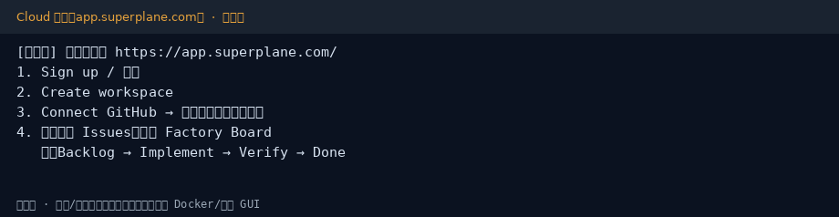
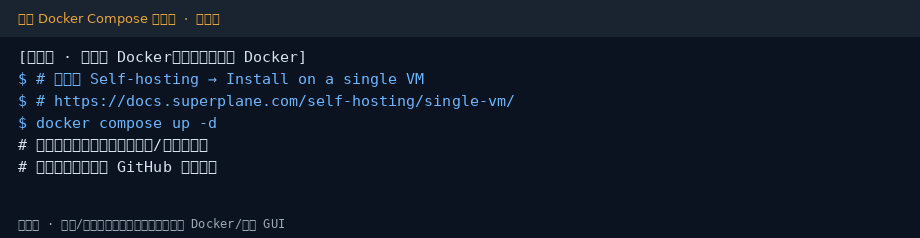
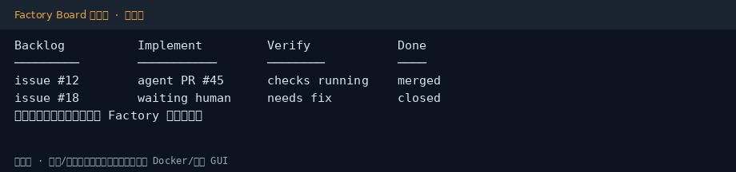

# SuperPlane 小白中文教程

> 开源「软件工厂」：把高置信度 backlog Issue 自动变成可审 PR（社区非官方教程）  
> 上游：[`superplanehq/superplane`](https://github.com/superplanehq/superplane) · 官网：[superplane.com](https://superplane.com) · 文档：[docs.superplane.com](https://docs.superplane.com/)  
> 教程校对：2026-10-30（Asia/Shanghai）· Cloud / 单机自托管步骤以官方文档为准（本环境**无 Docker**，自托管与界面为**示意图**）

[](https://github.com/xianyu110/awesome-superplane-zh)
[](https://github.com/superplanehq/superplane)
[](LICENSE)
[](https://xianyu110.github.io/awesome-superplane-zh/)

---

## 截图索引

| # | 文件 | 类型 | 说明 |
|---|------|------|------|
| 1 | [`images/01-cloud-signup.png`](images/01-cloud-signup.png) | **示意图** | Cloud：注册 → 连 GitHub → 进 Factory |
| 2 | [`images/02-selfhost-compose.png`](images/02-selfhost-compose.png) | **示意图** | 单机 VM + Docker Compose 自托管摘要 |
| 3 | [`images/03-factory-board.png`](images/03-factory-board.png) | **示意图** | Factory 列：Backlog → Implement → Verify → Done |

> 本沙箱无 Docker、未登录 app.superplane.com，故配图均为示意图；命令与列名请以你账号内界面及官方文档为准。

---

## 这是什么？

**SuperPlane** 把「例行、高置信度」的工程任务交给 coding agent 流水线，并在同一套可见流程里做校验与打回，让人专注需要判断的部分。

官方概括的流水线阶段：

- **Backlog** 入站与精炼  
- **Implement** agent 实现  
- **Verify** 检查 / 打回  
- **Done** 交付到人工审阅（如 PR）

可选 **Cloud**（[app.superplane.com](https://app.superplane.com/)）或 **Self-host**（Docker Compose 等）。开源主体为 **Apache-2.0**；仓库内 `/ee` 目录另有 Enterprise Edition 许可，自托管前请阅读上游 `LICENSE` / `ee/LICENSE`。

本仓库只提供**中文小白教程**（MIT），不二次分发上游软件。

---

## 官方链接（请以官方为准）

| 资源 | 链接 |
|------|------|
| 源码 | https://github.com/superplanehq/superplane |
| 官网 | https://superplane.com |
| Cloud 登录 | https://app.superplane.com/ |
| 文档 | https://docs.superplane.com/ |
| Quickstart | https://docs.superplane.com/get-started/quickstart/ |
| 自托管总览 | https://docs.superplane.com/self-hosting/overview/ |
| 单机 VM 安装 | https://docs.superplane.com/self-hosting/single-vm/ |
| Discord | https://discord.superplane.com/ |

---

## 环境要求（摘要）

### Cloud（上手最快）

- 浏览器 + 可授权的 **GitHub** 账号 / 仓库  
- 按官方 Quickstart 选择小 bug、测试修复或文档类 Issue 做第一次跑通

### 单机自托管（官方「Install on a single VM」）

摘自官方文档（细节以该页为准）：

- Linux VM（**amd64** 或 **arm64**），管理员权限  
- **Docker Engine** + **Docker Compose v2**，以及 bash / curl / tar / OpenSSL  
- 出站 HTTPS 可访问 GitHub Releases、**ghcr.io**、Docker Hub  
- 你控制的域名（如 `superplane.example.com`），入站 **TCP 80/443**  
- 资源：官方建议为每个并发 runner 预留约 **2 vCPU / 8GB 内存 / 30GB 磁盘**；默认 fleet 会保持 runner 就绪并限制并发数——以文档数字为准

---

## 安装与上手

### 路径 A：SuperPlane Cloud（推荐小白先试）

1. 打开 [app.superplane.com](https://app.superplane.com/) 注册 / 登录  
2. 创建 workspace  
3. 连接 GitHub，选择可授权仓库  
4. 导入近期 Issues，进入 Factory Board  
5. 选一个**小而清晰**的任务做第一次 agent 跑通  



更细的点击路径见官方 [Quickstart](https://docs.superplane.com/get-started/quickstart/)。

### 路径 B：单机 Docker Compose 自托管

> 以下命令摘自官方 [Install on a single VM](https://docs.superplane.com/self-hosting/single-vm/)。**版本号请换成你安装当天文档/Release 写明的值**（教程撰写时文档示例为 `VERSION=v1.0.0`；Release 页亦有 `v1.0.0` 等标签）。

1. **DNS**：为 hostname 建 A/AAAA 记录，指向 VM 公网地址；可用 `dig +short … @8.8.8.8` 核对。  
2. **下载并解压**（在 VM 上）：

```bash
VERSION=v1.0.0   # ← 换成官方文档/Release 当前值
curl -fsSL -o superplane-single-host.tar.gz \
  "https://github.com/superplanehq/superplane/releases/download/${VERSION}/superplane-single-host.tar.gz"
tar -xzf superplane-single-host.tar.gz
cd superplane
```

3. 按同页 **「3. Install SuperPlane」** 之后的步骤执行安装脚本 / Compose（本教程不复述可能变更的脚本参数）。  
4. 验证安装 → 创建 owner 账号 → 再按文档接 GitHub / agent。



云厂商多节点安装见 [Install on your cloud](https://docs.superplane.com/self-hosting/overview/)。排错见官方 Troubleshooting。

### Factory 列示意



---

## 第一次演示任务（建议）

1. Cloud 或自托管就绪后，连上一个**非生产**仓库  
2. 挑文档 typo / 单测修复级 Issue（官方 Quickstart 也建议从小任务开始）  
3. 观察 Backlog → Implement → Verify → Done，人工审 PR  
4. 失败时看 Verify 打回信息，再决定是否放权给 agent

---

## 常见报错与解决

| 现象 | 可能原因 | 处理 |
|------|----------|------|
| 自托管装不上 | 无 Docker / Compose v2 | 先按 Docker 官方文档装引擎与 Compose 插件 |
| HTTPS / 证书失败 | DNS 未生效或 80/443 未放行 | 复查 dig 与安全组；等 DNS TTL |
| 拉不动镜像 | 无法访问 ghcr.io / Docker Hub | 配置可达的出站或镜像策略（以你环境合规为准） |
| agent 跑不动 | 未配置官方支持的 coding agent / 密钥 | 见文档「Coding agents and AI」；**不要把密钥写进仓库** |
| `/ee` 相关功能 | 企业版许可 | 阅读上游 `ee/LICENSE`，开源路径勿混用未授权组件 |

---

## 许可证与合规

- **本教程文字与配图**：MIT（见 [LICENSE](LICENSE)）  
- **上游 SuperPlane**：主要为 **Apache-2.0**；`/ee` 为企业许可——部署前必读上游 LICENSE  
- **不硬推**未备案境外模型或 API 中转。Factory 里配置模型 / agent 时，优先 DeepSeek、Ollama、已备案或你已有订阅的兼容端；具体引擎名单以官方 Integrations 文档为准  
- 可选软链：[tryallapi.com](https://tryallapi.com/?aff=5A6A)（aff=5A6A）；店铺仅 [MaynorAI](https://wzyp.cn/shop/maynorai)

与 SuperPlane / Semaphore 等官方**无隶属关系**。Cloud 定价与配额以官网 Billing 为准，本教程不编造价格。

---

## GitHub Pages

图文镜像页：https://xianyu110.github.io/awesome-superplane-zh/
